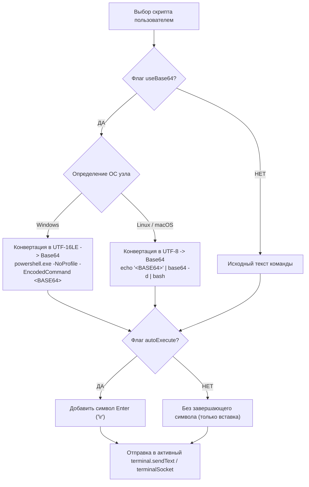

# QuickTerminalScripts (MeshCentral Plugin)

[](https://github.com/Ylianst/MeshCentral)
[](LICENSE)
[](config.json)

Серверно-клиентский плагин для системы удаленного управления **MeshCentral**, добавляющий на вкладку **«Терминал» (Terminal)** интерактивную панель быстрого запуска предустановленных скриптов и команд.

Автоматизирует рутинные операции системного администрирования за счет инжекции однострочных и многострочных скриптов непосредственно в активную консольную сессию узла (`xterm.js`) с автоматической фильтрацией по операционной системе и возможностью безопасного запуска через Base64-обертку.

---

## 🚀 Основные возможности

- ⚡ **Быстрая инжекция в терминал:** Выбор и отправка команд в активный `xterm.js` / WebSocket сеанс одним кликом или нажатием клавиши Enter.
- 🎯 **Умная фильтрация по ОС:** Автоматическое определение операционной системы текущего хоста (`Windows`, `Linux`, `macOS`) и отображение только совместимых скриптов (плюс скриптов с тегом `all`).
- 🔒 **Безопасная Base64-обертка:**
  - **Windows (PowerShell):** Автоматическая конвертация скрипта в **Strict UTF-16LE** и исполнение через `powershell.exe -NoProfile -EncodedCommand <BASE64>` (защита от разрыва строк, кириллицы и спецсимволов).
  - **Linux / macOS (Bash):** Кодирование в **UTF-8** и безопасное исполнение через `echo '<BASE64>' | base64 -d | bash`.
- 🔍 **Combobox с живым поиском:** Мгновенный поиск по названию и телу команды с полной поддержкой навигации стрелками клавиатуры (Up / Down / Enter / Escape).
- ⚙️ **Административная CRUD-панель:** Встроенное модальное окно для добавления, редактирования и удаления команд (доступно только пользователям с правами администратора сервера).
- 🛡️ **Защита данных при обновлениях (Data Persistence):** База пользовательских скриптов `quickterminalscripts.json` хранится в каталоге данных сервера `meshcentral-data/` вне директории плагина, сохраняясь при обновлениях через GitHub.
- 🔐 **Серверный контроль безопасности:** Проверка прав администратора `user.siteadmin` строго на бэкенде Node.js с защитой от спуфинга и атомарной записью с резервным копированием `.bak`.

---

## 🖥️ Интерфейс в действии

Панель инструментов компактно встраивается в панель управления вкладки «Терминал»:

```text
[ Connect ] [ ⚡ Быстрые скрипты...  ▼ ] [ Выполнить ] [ ⚙️ ]
```

### Схема конвейера полезной нагрузки (Payload Builder):



---

## 📦 Структура репозитория

```text
meshcentral-quickterminalscripts/
├── .gitignore
├── LICENSE                   # Лицензия MIT
├── README.md                 # Документация и руководство
├── changelog.md              # Журнал версий
├── config.json               # Манифест плагина для менеджера плагинов MeshCentral
├── quickterminalscripts.js   # Серверный модуль (Node.js backend, маршруты и API)
├── scripts.default.json      # Дефолтный шаблон команд (поставляется с плагином)
└── public/
    ├── terminalscripts.js    # Клиентский модуль (UI, комбобокс, кодирование и инжекция)
    └── terminalscripts.css   # Стили тулбара, комбобокса, бейджей и модального окна
```

---

## 📥 Установка плагина

### Способ 1: Установка через Web UI MeshCentral (Рекомендуемый)

1. Войдите в веб-интерфейс MeshCentral под учетной записью **Администратора**.
2. Перейдите в раздел **«My Server»** $\rightarrow$ вкладка **«Plugins»**.
3. Нажмите кнопку **«Install Plugin»** (или «Download Plugin»).
4. В поле ввода укажите URL репозитория:
   ```text
   https://github.com/Sokol549/meshcentral-quickterminalscripts
   ```
5. MeshCentral автоматически скачает архив, распакует плагин в `meshcentral-data/plugins/quickterminalscripts` и активирует его.

### Способ 2: Ручная установка на сервере

1. Перейдите в каталог данных вашего сервера MeshCentral:
   ```bash
   cd meshcentral-data/plugins
   ```
2. Склонируйте репозиторий в папку `quickterminalscripts`:
   ```bash
   git clone https://github.com/Sokol549/meshcentral-quickterminalscripts.git quickterminalscripts
   ```
3. Перезапустите сервер MeshCentral или включите плагин во вкладке «Plugins» веб-панели.

---

## 🔄 Обновление плагина

При выходе новых версий:
1. В интерфейсе MeshCentral: **My Server** $\rightarrow$ **Plugins**.
2. Нажмите кнопку **«Update»** напротив плагина QuickTerminalScripts.
3. Код плагина обновится из GitHub, а файл ваших команд `quickterminalscripts.json` в `meshcentral-data/` останется полностью нетронутым.

---

## 📝 Спецификация модели данных (`scripts.json` / `quickterminalscripts.json`)

Хранилище представляет собой плоский JSON-массив объектов:

```typescript
interface TerminalScript {
  id: string;             // UUID v4
  title: string;          // Отображаемое название команды в списке
  targetOS: "windows" | "linux" | "macos" | "all"; // Целевая ОС
  autoExecute: boolean;   // true = отправить Enter, false = только подставить в консоль
  useBase64: boolean;     // true = обернуть в safe-wrapper (PowerShell / Bash)
  content: string;        // Тело скрипта (однострочное или многострочное)
}
```

### Пример предустановленных команд:

```json
[
  {
    "id": "e4b1-4f92-91a0",
    "title": "Перезапуск службы Spooler (Print Spooler)",
    "targetOS": "windows",
    "autoExecute": true,
    "useBase64": false,
    "content": "Restart-Service -Name Spooler -Force"
  },
  {
    "id": "c1a2-3b4c-5d6e",
    "title": "Сбор диагностических данных (PowerShell многострочный)",
    "targetOS": "windows",
    "autoExecute": true,
    "useBase64": true,
    "content": "Get-Process | Sort-Object CPU -Descending | Select-Object -First 10;\nGet-Service | Where-Object {$_.Status -eq 'Stopped' -and $_.StartType -eq 'Automatic'}"
  },
  {
    "id": "a9f8-7e6d-5c4b",
    "title": "Проверка использования диска (df -h)",
    "targetOS": "linux",
    "autoExecute": false,
    "useBase64": false,
    "content": "df -h | grep -v tmpfs"
  }
]
```

---

## 🛡️ Безопасность и отказоустойчивость

- **Проверка прав администратора на бэкенде:** Проверка `user.siteadmin` выполняется исключительно на сервере при каждом обращении к API сохранения. Попытки несанкционированного сохранения отклоняются с кодом `403 Forbidden`.
- **Атомарная запись и бэкапы:** Перед записью проверяется валидность JSON (`JSON.parse`). Создается резервная копия `quickterminalscripts.json.bak`, а запись на диск выполняется атомарно через `.tmp`-файл, исключая повреждение данных при отключении питания или сбоях сервера.
- **Изоляция стилей:** Все CSS-классы плагина снабжены префиксом `.qts-`, предотвращая конфликты с глобальными стилями тем оформления MeshCentral.

---

## 📄 Лицензия

Проект распространяется под лицензией [MIT](LICENSE).
Автор: Alex
